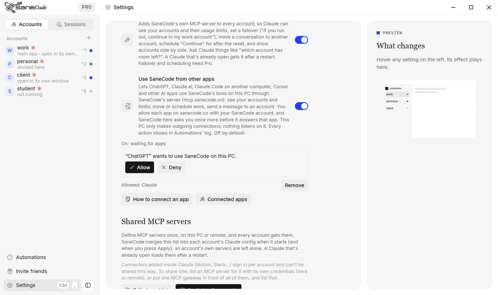
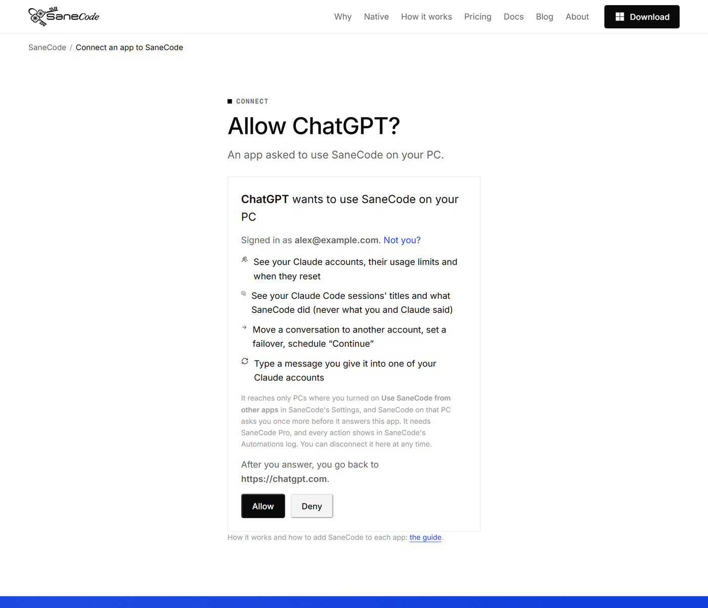
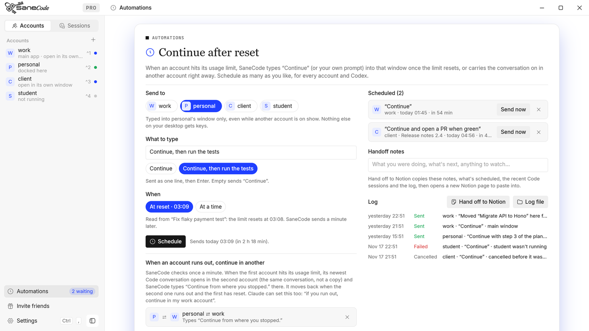
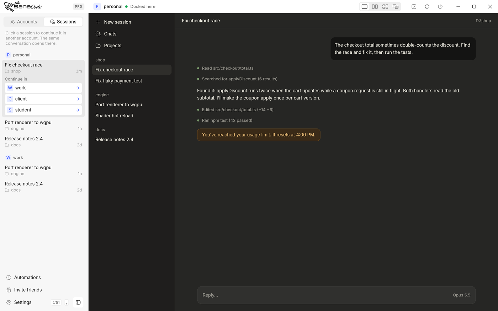
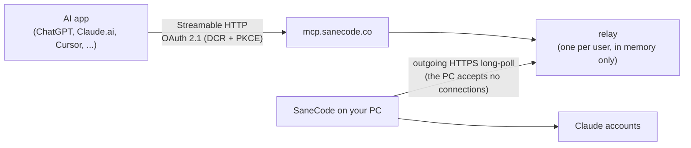
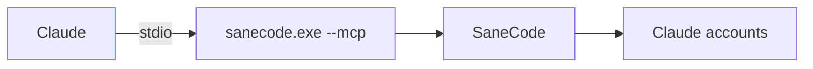
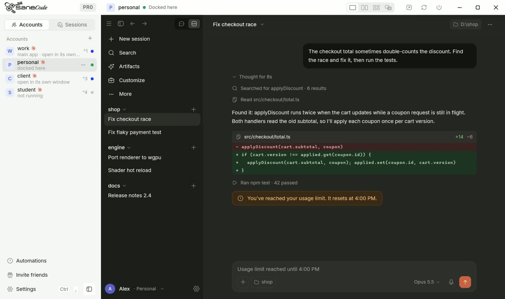
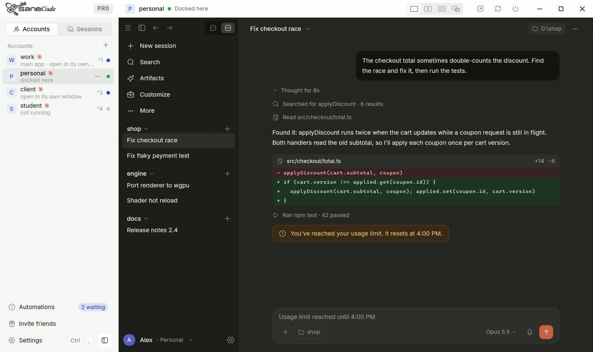

<div align="center">

<a href="https://sanecode.co">
  <picture>
    <source media="(prefers-color-scheme: dark)" srcset="docs/images/sanecode-logo-white.svg">
    
  </picture>
</a>

### MCP server: see every Claude account's usage limits and keep work going when one runs out

[Website](https://sanecode.co) · [Docs](https://sanecode.co/docs/) · [Download for Windows](https://sanecode.co/docs/install-sanecode-on-windows/) · [Connect ChatGPT](https://sanecode.co/docs/use-sanecode-from-chatgpt-claude-and-other-ai-apps/)

[](https://github.com/dusy4/sanecode-mcp-server/actions/workflows/ci.yml)
[](LICENSE)
[](https://modelcontextprotocol.io)
[](https://mcp.sanecode.co/mcp)
[](#is-it-secure)
[](https://sanecode.co/docs/install-sanecode-on-windows/)
[](Cargo.toml)

[](https://insiders.vscode.dev/redirect/mcp/install?name=sanecode&config=%7B%22type%22%3A%22http%22%2C%22url%22%3A%22https%3A%2F%2Fmcp.sanecode.co%2Fmcp%22%7D)
[](https://cursor.com/install-mcp?name=sanecode&config=eyJ1cmwiOiJodHRwczovL21jcC5zYW5lY29kZS5jby9tY3AifQ%3D%3D)

</div>

SaneCode is a Windows app that allows you to run several Claude Desktop accounts at the same time without having to constantly relogin, each in the
official Claude desktop app. Its MCP server lets Claude,
ChatGPT and other AI apps and agents see every account's usage limits and keep your work going when one
runs out. Download and full documentation: **[sanecode.co](https://sanecode.co)**.

This repository holds the protocol layer and the tool definitions SaneCode ships, plus a demo
host with made-up accounts you can try in any MCP client. The SaneCode app and the remote server
are not open source.

## How it looks

<table>
  <tr>
    <td width="50%" valign="top">
      <a href="https://sanecode.co/docs/use-sanecode-from-chatgpt-claude-and-other-ai-apps/"></a>
      <br><sub><b>Use SaneCode from other apps</b>: turn it on, then allow each app once on your PC.</sub>
    </td>
    <td width="50%" valign="top">
      <a href="https://sanecode.co/docs/use-sanecode-from-chatgpt-claude-and-other-ai-apps/"></a>
      <br><sub><b>The sanecode.co consent page</b>: what the app can see and do, before you allow it.</sub>
    </td>
  </tr>
  <tr>
    <td width="50%" valign="top">
      <a href="https://sanecode.co/docs/let-claude-use-sanecode-mcp-failover/"></a>
      <br><sub><b>Automations</b>: a scheduled "Continue" at the reset, a failover from personal to work, and the log of every action.</sub>
    </td>
    <td width="50%" valign="top">
      <a href="https://sanecode.co/docs/continue-claude-session-in-another-account/"></a>
      <br><sub><b>Sessions</b>: an account hit its limit; continue the same conversation in another account.</sub>
    </td>
  </tr>
</table>

## Quick start

Connect any AI app that takes a remote MCP URL (needs [SaneCode Pro](https://sanecode.co/pro/)):

1. In SaneCode, turn on **Settings → Tools for Claude → Use SaneCode from other apps**.
2. In your AI app, add a custom MCP server (connector) with this URL:

   ```
   https://mcp.sanecode.co/mcp
   ```

3. Sign in on sanecode.co and allow the app, then press **Allow** once more in SaneCode on your PC.

Inside SaneCode there is nothing to connect: every Claude account it runs already has the tools.
Full steps for each app: [use SaneCode from ChatGPT, Claude.ai and other AI apps](https://sanecode.co/docs/use-sanecode-from-chatgpt-claude-and-other-ai-apps/).

## What can an AI app do with SaneCode MCP?

With the SaneCode MCP server, Claude Desktop running on your computer(inside each of your accounts) or any AI app that speaks MCP
can:

- **See usage limits and resets**: which accounts are running and signed in, which one hit its
  limit and when it resets.
- **See sessions**: Claude Code sessions across accounts, by title, folder and time.
- **Report overnight activity**: what SaneCode moved, typed or scheduled while you were away(SaneCode automations allow you to nudge a session after a session limit reset, to continue work going even after you're away or asleep).
- **Set a failover**: when one account hits its limit, the same conversation continues in
  another account, and moves back after the reset. SaneCode automations make it possible.
- **Move a conversation now** to an account with free usage limits room left.
- **Schedule Continue after the reset**: type a prompt into a Claude at the reset or at a time defined by you.
- **Type a prompt into an account**: your own words, into that account's Claude.
- **Show accounts side by side**: one, a split of two, or a grid of four.

The AI app reports and dispatches; Claude in each of your accounts does the work. More on how
this works inside SaneCode: [let Claude use SaneCode for limits and failover](https://sanecode.co/docs/let-claude-use-sanecode-mcp-failover/).

## Tools

| Tool | What it's for | Kind | Plan |
| --- | --- | --- | --- |
| `sanecode_accounts_and_limits` | Every account, which are running and signed in, which hit a limit and when it resets | Read-only | Free |
| `sanecode_sessions` | Claude Code sessions across accounts (titles, folders, times; no content) | Read-only | Free |
| `sanecode_activity` | What SaneCode did while you were away | Read-only | Free |
| `sanecode_list_automations` | Failover rules and scheduled prompts | Read-only | Free |
| `sanecode_cancel_automation` | Cancel a failover rule or scheduled prompt | Acts | Free |
| `sanecode_continue_in_account` | Continue this conversation in another account now | Acts | Free |
| `sanecode_open_accounts` | Show accounts in SaneCode, side by side | Acts | Free |
| `sanecode_set_failover` | If this account hits its limit, continue in another | Acts | Pro |
| `sanecode_schedule_continue` | Type a prompt into a Claude later (after the reset) | Acts | Pro |
| `sanecode_send_prompt` | Type your message into an account's Claude now | Acts | Pro |

Every tool used from outside your Claude accounts, through `mcp.sanecode.co`, needs
[SaneCode Pro](https://sanecode.co/pro/) ($29 once). Full descriptions, parameters and MCP
annotations: [docs/tools.md](docs/tools.md) (generated from [tools.json](tools.json), the list
`mcp.sanecode.co` serves).

## Example prompts

- "Which of my Claude accounts has room left? When does my limit reset?"
- "Refactor all 60 handlers, I'll check in the morning. If you run out, continue in work."
- "I'm out of usage, move this to my other account."
- "Continue this when the limit resets."
- "What happened overnight? Did the failover kick in?"
- "Tell my work Claude to run the tests and open a PR."
- "What's scheduled? Stop the failover, I'm back."
- "Put work and personal side by side."

## How do I connect it?

**Inside SaneCode: nothing to do.** SaneCode adds its MCP server (`sanecode.exe --mcp`) to every
Claude account it runs, on by default in Settings → Tools for Claude.
[Install SaneCode on Windows](https://sanecode.co/docs/install-sanecode-on-windows/).

**From other AI apps (Pro):** turn on Settings → Tools for Claude → *Use SaneCode from other
apps* in SaneCode, then add the remote server `https://mcp.sanecode.co/mcp`. The app opens
sanecode.co to sign in and allow it once; SaneCode on your PC asks once more.
Step by step for every app: [use SaneCode from ChatGPT, Claude.ai and other AI apps](https://sanecode.co/docs/use-sanecode-from-chatgpt-claude-and-other-ai-apps/).

<details>
<summary><b>ChatGPT</b></summary>

Plugins → Add → Add custom MCP server, URL `https://mcp.sanecode.co/mcp`, Authentication: OAuth.
[ChatGPT steps](https://sanecode.co/docs/use-sanecode-from-chatgpt-claude-and-other-ai-apps/#how-do-i-add-it-to-each-app)

</details>

<details>
<summary><b>Claude.ai and Claude desktop</b></summary>

Settings → Connectors → Add custom connector, URL `https://mcp.sanecode.co/mcp`.
[Claude.ai steps](https://sanecode.co/docs/use-sanecode-from-chatgpt-claude-and-other-ai-apps/#how-do-i-add-it-to-each-app)

</details>

<details>
<summary><b>Claude Code</b> (on another computer)</summary>

```
claude mcp add --transport http sanecode https://mcp.sanecode.co/mcp
```

Then `/mcp` → sanecode → Authenticate.

</details>

<details>
<summary><b>Cursor, Windsurf</b> and other clients that take a remote MCP URL</summary>

```json
{ "mcpServers": { "sanecode": { "url": "https://mcp.sanecode.co/mcp" } } }
```

Or use the **Add to Cursor** button at the top. See [examples/cursor.json](examples/cursor.json).

</details>

<details>
<summary><b>VS Code</b></summary>

VS Code's `mcp.json` uses `"servers"` with `"type": "http"`:

```json
{ "servers": { "sanecode": { "type": "http", "url": "https://mcp.sanecode.co/mcp" } } }
```

Or use the **Install in VS Code** button at the top. See [examples/vscode-mcp.json](examples/vscode-mcp.json).

</details>

## How does it work?

**Remote (Pro)**



**Local (inside your Claude accounts)**



Remote and local calls take the same code path on the PC: the relay hands each call to
`sanecode.exe --mcp`, which asks the open SaneCode app. The app owns the Claude windows; it moves
conversations with Claude's own resume link and types prompts into the official Claude desktop
app. How continuing works: [continue Claude after the usage limit resets](https://sanecode.co/docs/continue-claude-after-usage-limit-resets/).

## Videos

Narrated walkthroughs of the features these tools drive, recorded in the app with made-up accounts.

<table>
  <tr>
    <td width="50%" valign="top">
      <a href="https://sanecode.co/docs/continue-claude-session-in-another-account/"></a>
      <br><sub>▶ <a href="https://sanecode.co/docs/continue-claude-session-in-another-account/">Continue a Claude session in another account</a> (0:33) · <a href="https://sanecode.co/video/continue-claude-session-in-another-account.mp4">mp4</a></sub>
    </td>
    <td width="50%" valign="top">
      <a href="https://sanecode.co/docs/continue-claude-after-usage-limit-resets/"></a>
      <br><sub>▶ <a href="https://sanecode.co/docs/continue-claude-after-usage-limit-resets/">Continue Claude after the usage limit resets</a> (0:31) · <a href="https://sanecode.co/video/continue-claude-after-usage-limit-resets.mp4">mp4</a></sub>
    </td>
  </tr>
</table>

## Is it secure?

- **Your PC accepts no connections.** SaneCode asks the relay for work with outgoing HTTPS
  requests; nothing listens on the PC. Locally there is no network port at all (stdio).
- **Only PCs you turned on**, signed in to the same SaneCode account. Turn it off and calls stop.
- **Approved twice, per app**: on sanecode.co, and again in SaneCode on your PC. An app SaneCode
  doesn't recognise is flagged as **Unverified app** with the address it returns to.
- **No commands from outside**: text an app types can't start with `!`, `/`, `#` or `@`.
- **Standard OAuth 2.1 with PKCE**; access tokens last an hour and renew. See and disconnect
  apps on [your connected apps page](https://sanecode.co/connect/).
- **Nothing from your Claude accounts is stored or logged** on the server. SaneCode never reads
  what you and Claude said: only session titles, folders, times and limit lines.
- **Every action is in SaneCode's Automations log**, and a typed message is exactly the text the
  app sent.

Details: [SaneCode privacy policy](https://sanecode.co/privacy/). Report a vulnerability:
[SECURITY.md](SECURITY.md).

## What's in this repo?

| Path | What |
| --- | --- |
| `src/lib.rs` | The protocol layer SaneCode ships: MCP over JSON-RPC on stdio, and the `Host` trait the app implements |
| `src/tools.rs` | The server instructions and the 10 tool definitions |
| `src/tests.rs` | Protocol tests, and a check that `tools.json` matches the code |
| `src/bin/demo.rs` | A demo host with made-up accounts (`personal`, `work`, `client-acme`); actions only say what SaneCode would do |
| `tools.json` | The tool list `mcp.sanecode.co` serves |
| `docs/tools.md` | Every tool in full, generated by `python scripts/tools_md.py` |
| `examples/` | Client configs |
| `server.json` | The entry for the official MCP registry |

The SaneCode app (the host that reads accounts and acts on Claude windows) and the remote server
with its relay are closed source. The files above are copied from the app with every release.

### Run the demo

Needs Rust 1.85 or newer. Nothing on your PC changes.

```
cargo test
cargo run --bin sanecode-mcp-demo                 # MCP over stdio
cargo run --bin sanecode-mcp-demo -- --describe   # print the tools as JSON
npx @modelcontextprotocol/inspector cargo run --bin sanecode-mcp-demo
```

Or with Docker: `docker build -t sanecode-mcp-demo .` then `docker run -i --rm sanecode-mcp-demo`.

## Feedback

If SaneCode's tools help you, a ⭐ on this repo helps others find them. Questions, ideas and bugs:
[open an issue](https://github.com/dusy4/sanecode-mcp-server/issues), or see the
[SaneCode FAQ and troubleshooting](https://sanecode.co/docs/sanecode-faq-and-troubleshooting/).

## License

The code in this repository is [MIT](LICENSE). The SaneCode app is commercial software:
free for up to 2 accounts, [Pro](https://sanecode.co/pro/) for more.

---

SaneCode is an independent product by 12industries, not affiliated with, endorsed by or sponsored
by Anthropic. Claude is a trademark of Anthropic, PBC.
